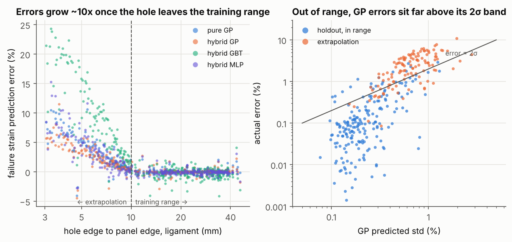
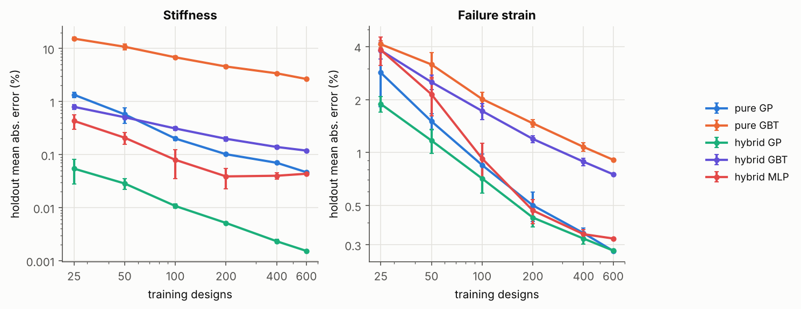
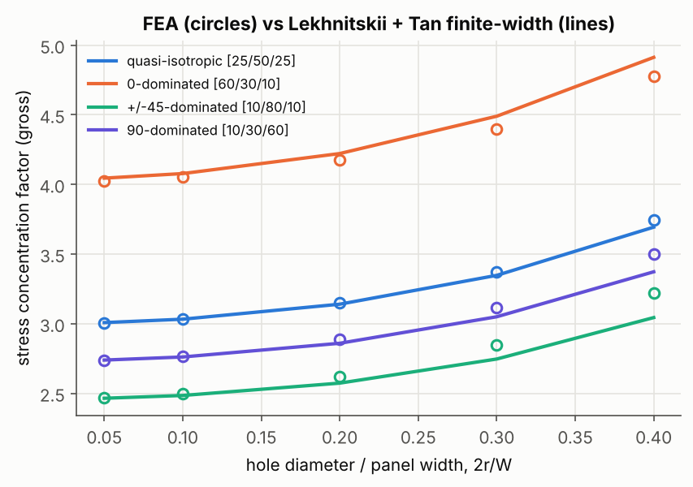
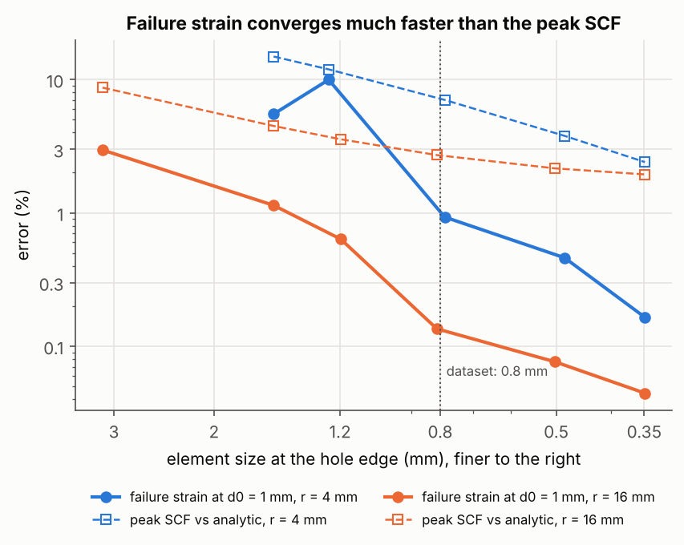

# Composite panel surrogate

ML surrogate models for a carbon/epoxy panel with a circular cutout, trained on
data from a 2D finite element solver written from scratch in Python and validated
against closed-form solutions.

Given the layup (fractions of 0°, ±45°, 90° plies), the thickness and the hole's
size and position, the surrogates predict:

- **axial stiffness** of the panel (N/mm)
- **failure strain**: the far-field strain at which the first ply fails next to the
  hole (Tsai–Wu, point-stress criterion at 1 mm from the hole edge)

**Status:** working end to end; under active development (see [Next steps](#next-steps)).

## Results at a glance

| | Holdout error, in range (mean / 95th pct) | Extrapolation error, hole near edge (mean / max) |
|---|---|---|
| Stiffness, hybrid GP | 0.002 % / 0.01 % | 0.11 % / 0.7 % |
| Failure strain, hybrid GP | 0.28 % / 1.2 % | 2.7 % / 11.5 % |
| Failure strain, pure GP | 0.28 % / 0.95 % | 3.7 % / 10.6 % |
| Failure strain, gradient-boosted trees | 0.9 % / 2.1 % | 9.6 % / 26 % |

Holdout: 200 designs from the training range, never used for fitting.
Extrapolation: 120 designs with the hole 3–10 mm from the panel edge (training used ≥ 10 mm).

What I took from it:

1. **Inside the training range the problem is easy for a Gaussian process.** With 600
   runs, the GP's error on failure strain (≈ 0.3 %) is about the size of the mesh
   discretisation error in the labels, so more ML effort there buys little.
2. **Physics helps most when data is scarce.** Letting laminate theory supply the
   no-hole stiffness and learning only the hole's knock-down cuts the stiffness error
   from 1.3 % to 0.05 % with 25 training runs. It helps far less for failure strain,
   because the no-hole failure strain is almost the same for every layup here and
   tells the model little.
3. **Out of range, every model is wrong in the unsafe direction.** For holes closer to
   the edge than anything seen in training, the errors grow about 10× and 88–98 % of
   predictions *over*-estimate the failure strain.
4. **The GP's uncertainty does not warn you there.** Its 95 % interval holds the true
   value for ~90 % of in-range designs but only ~20 % of the extrapolation set.
5. **Active learning gave a small, consistent gain** (0.51 % vs 0.57 % error at 150
   runs), not a dramatic one, on a problem this smooth.




## Evaluation

A random holdout alone would have made these models look ready to use. Each test
below asks a different question:

| Test | Data | Question it answers |
|---|---|---|
| 5-fold cross-validation | 600 training designs | Which model and set-up to pick |
| Holdout | 200 in-range designs, never used for fitting | How accurate is it in normal use? |
| Extrapolation | 120 designs with the hole 3–10 mm from the edge (training ≥ 10 mm) | What happens just outside the data? |
| Error direction | extrapolation set | Are the errors on the safe or unsafe side? |
| Uncertainty check | GP 95 % intervals on both sets | Does the model know when it doesn't know? |
| Label-noise floor | mesh convergence study | How small an error is still meaningful? |

Failure strain, hybrid GP (all numbers in `results/ml_results.json`):

| | Holdout | Extrapolation |
|---|---|---|
| Mean error | 0.28 % | 2.7 % |
| Worst error | 2.9 % | 11.5 % |
| True value inside the GP's 95 % interval | 90 % | 23 % |

Across all models, 88–98 % of extrapolation predictions *over*-estimate the failure
strain, which is the unsafe direction for a sizing tool. The pure GP's intervals do
no better (92 % in range, 18 % outside).

**What this means in practice:** a model that is 0.3 % accurate on a random holdout
can be 10 % wrong, in the unsafe direction, one step outside its training data,
and its own uncertainty will not flag it. Before trusting a surrogate like this I
would want:

1. a check that every new design lies inside the training range, and
2. a test set built deliberately at the edges of that range, not only a random split.

Neither is implemented yet; both are on the list below.

## How it works

```
layup + hole ──► laminate theory (A matrix) ──► graded T6 mesh ──► FEA: pull test
                                                                     │
                     stiffness = reaction / displacement  ◄──────────┤
   failure strain = point-stress (1 mm) + Tsai–Wu, worst ply  ◄──────┘
```

1. **Laminate theory** (`src/panel/clt.py`): ply stiffness rotated to each angle and
   summed into the A matrix for a symmetric, balanced laminate. T300/5208-type ply data.
2. **Mesh** (`src/panel/mesh.py`): no external mesher. Rings of nodes around the
   hole (spacing grows with radius), a background grid further away, matching
   spacing along the edges, Delaunay triangulation, then 6-node quadratic triangles
   with the hole's mid-side nodes snapped to the circle.
3. **FEA** (`src/panel/fea.py`): plane-stress membrane, constitutive law N = A·ε,
   3-point Gauss integration, `scipy.sparse` solve. Left edge on rollers, right edge
   pulled by a uniform displacement. 0.2–1.5 s per run.
4. **Outputs** (`src/panel/analysis.py`): stiffness from the reaction force; failure
   strain by sampling strain on a circle 1 mm outside the hole edge, rotating into
   each ply, Tsai–Wu strength ratio, worst point and ply. A characteristic distance
   gives a well-posed target; the peak stress at the hole edge depends on the mesh.
5. **Dataset** (`scripts/02_generate_dataset.py`): Latin hypercube over ply fractions
   (each ≥ 10 %), thickness 2–6 mm, hole radius 4–16 mm, hole position. Panel 200 × 100 mm.
6. **Models** (`scripts/03_train_models.py`): Gaussian process (ARD Matérn 5/2),
   gradient-boosted trees and an MLP, each as *pure* (design variables → log target)
   and *hybrid* (laminate theory gives the no-hole value; the model learns the log of
   the hole's knock-down, with Lekhnitskii's Kt as an extra feature). 5-fold CV,
   holdout, learning curves, active learning, extrapolation test.

## Validation of the solver

| Check | Result |
|---|---|
| No hole vs laminate theory | stiffness matches to 1e-13 (relative) |
| Central hole vs Lekhnitskii + Tan finite-width correction | within 1 % for small holes (2r/W ≤ 0.1) on all four layups tested; up to 5.7 % at 2r/W = 0.4 for strongly orthotropic layups, where the correction itself is approximate |
| Mesh convergence of failure strain at 1 mm | ≤ 1 % change vs a 4× finer mesh at the element size used (0.8 mm at the hole edge) |




## Limitations

- **First-ply failure is matrix cracking.** With these strengths, the 90° (sometimes
  ±45°) plies fail first in almost every design. That is a conservative, matrix-driven
  target; notched strength for sizing is usually fibre-driven.
- **Membrane only.** No bending, so the stacking sequence does not matter and the
  failure strain is independent of thickness (the hybrid model uses that).
- **One load case** (uniaxial tension) and one material.
- **The point-stress distance (1 mm) is assumed**, not calibrated against tests.
- Label noise from the mesh is ≈ 0.1–1 %, so in-range errors below that are not meaningful.

## Next steps

- [ ] Fibre-failure target (e.g. max fibre strain in the 0° plies) alongside Tsai–Wu
- [ ] Better physics feature for failure: Lekhnitskii's full stress field evaluated at 1 mm
- [ ] Flag designs outside the training range before predicting (simple domain check)
- [ ] Add the near-edge region to training, then re-test extrapolation on a new boundary
- [ ] Compression and shear load cases
- [ ] Phase 2: buckling (plate bending + geometric stiffness, eigenvalue solve)

## Run it

```bash
pip install -r requirements.txt
python tests/test_fea.py                 # quick solver checks (also runs under pytest)
python scripts/01_validate_fea.py        # validation, ~6 min
python scripts/02_generate_dataset.py    # 920 FEA runs, ~8 min on 2 cores
python scripts/03_train_models.py        # all ML experiments, ~20 min
python scripts/03_train_models.py --plots-only   # redraw figures only
```

```
src/panel/   clt.py  mesh.py  fea.py  analytic.py  analysis.py
scripts/     01_validate_fea.py  02_generate_dataset.py  03_train_models.py
data/        train.csv (800 runs)  extrap.csv (120 runs)
results/     validation.json  ml_results.json  figures/
tests/       test_fea.py
```

---

*Built with AI assistance (Claude); the problem definition and validation approach are mine. I'm reviewing and extending the code.*
